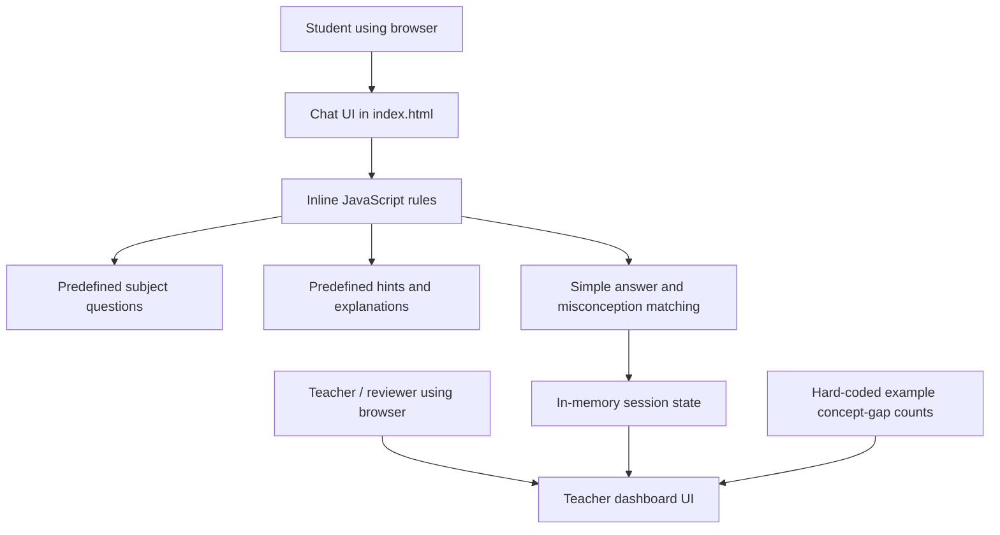
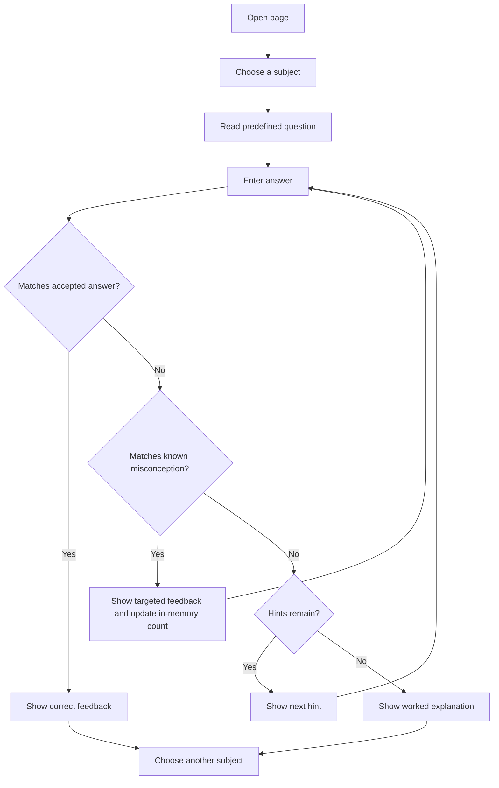

# Technical Design Document: Vidya Saathi

## 1. Purpose and scope

Vidya Saathi is a demonstration of a Socratic tutoring interface for Classes 6–8, accompanied by a teacher-facing concept-gap view. This document describes the code currently present in `index.html`, not a proposed production system.

## 2. Current architecture

The prototype is a single static web page. HTML defines the student chat panel and teacher dashboard, CSS styles the page, and inline JavaScript handles subject selection, answer matching, hints, and temporary dashboard updates.

**Not present:** external AI service, WhatsApp API, web server, database, authentication, persistent storage, or CSV import.

## 3. Main components

### 3.1 User interface

- `#phone`: student-style chat panel.
- `#chat`: displays messages.
- `#chips`: creates subject-selection buttons from the configured subjects.
- `#bar`: accepts a typed answer and sends it on button click or Enter.
- `#dash`: displays concept-gap labels and bar indicators.

### 3.2 Subject configuration

The JavaScript `S` object defines Math, Science, and Social Studies. Each subject contains:
- a display name and question;
- an answer-checking function;
- a list of recognized misconception patterns and corresponding feedback;
- a sequence of hints;
- a final explanation.

### 3.3 Session state

- `cur` tracks the currently selected subject.
- `tries` tracks attempts for the current question.
- `live` stores recognized concept-gap increments in browser memory.
- `gaps` contains initial demonstration counts.

When a predefined misconception pattern matches, the prototype increments that concept gap on the first attempt and re-renders the dashboard. These values are not persisted and are not derived from a real classroom dataset.

## 4. Student interaction flow

## 5. Teacher dashboard data flow

The `render()` function combines the fixed `gaps` object with any session increments in `live`, then renders labels and proportional bars. The dashboard is illustrative only. The CSV in `data/` is sample documentation data and is not read by the current application.

## 6. Data model

The current application has no persistent data model. Its in-memory concept-gap structure is conceptually:

| Field | Meaning |
|---|---|
| Concept-gap label | Name of a concept students may be missing |
| Initial count | Hard-coded demonstration count |
| Session increment | Number of recognized first-attempt misconceptions in the current browser session |
| Displayed count | Initial count plus session increment |

The sample CSV uses fictional `sample_record_id`, `grade`, `subject`, `concept_gap`, `example_status`, and `notes` fields. It is not connected to the live UI.

## 7. Security, privacy, and safety considerations

- Do not put API credentials or private student information in client-side HTML.
- The included CSV contains fictional examples only.
- Before any real school deployment, design consent, data minimization, retention, access controls, age-appropriate safeguarding, and teacher oversight.
- Do not interpret the example dashboard as validated learning analytics.

## 8. Setup and deployment

No build step is required. Open `index.html` in a modern browser. The page is static and can be hosted as static files if desired. There is no server configuration or environment variable requirement for the current version.

## 9. Known limitations and future work

1. Replace hard-coded questions with a documented content source.
2. Add automated tests and improve answer evaluation.
3. If required, design a separate backend and database with authentication and privacy controls.
4. Integrate a real AI model or messaging channel only as a separate, explicitly tested feature.
5. Add accessible keyboard and screen-reader testing.
